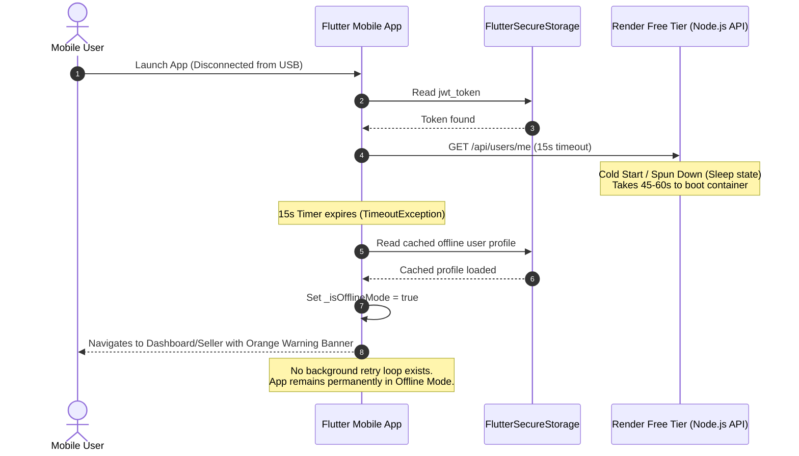

# 🚀 Architecture & Implementation Specification: Server Resilience & Always-On Connectivity

**Author:** Senior Backend Specialist & Lead Mobile Systems Architect  
**Project:** Captain Masala (Flutter Client + Node.js/Render Backend)  
**Date:** October 2026  
**Status:** Ready for Implementation  

---

## 1. Executive Summary & Root Cause Analysis

### 1.1 The Problem
When the user disconnected their mobile device from the development machine and launched the standalone application, the interface displayed:
> `⚠️ Offline Mode — Data may be outdated. Connect to server.`

### 1.2 Deep-Dive Root Causes



1. **Render Free Tier Spin-Down (Cold Start):**
   - Free instances on Render spin down into hibernation after **15 minutes of inactivity**.
   - Waking the instance up (container provision, Node runtime initialization, MongoDB connection pool establishment) takes between **45s and 75s**.
   - The Flutter client enforced a strict **15-second timeout** on the initial health check (`/users/me`), leading to guaranteed timeout failures on dormant instances.

2. **One-Way State Machine (No Silent Reconnection):**
   - In [`database_service.dart`](file:///d:/Captain_App/lib/core/services/database_service.dart), once `_isOfflineMode` is set to `true`, the app **never attempts to ping or reconnect** in the background.
   - The user is permanently stuck in `Offline Mode` until they manually kill and reopen the app after the server finishes waking up.

3. **Passive Banner UI (No User Control):**
   - The banner in [`seller_main_screen.dart`](file:///d:/Captain_App/lib/features/seller/seller_main_screen.dart) and [`dashboard_screen.dart`](file:///d:/Captain_App/lib/features/dashboard/dashboard_screen.dart) is purely static text (`Text('⚠️ Offline Mode...')`), with zero interactive affordance (no retry button, no status indicator).

---

## 2. Target Architecture

```mermaid
graph TD
    subgraph Client["Flutter Client (lib/)"]
        Init[App Launch] --> CheckConn{Check Connectivity & Ping}
        CheckConn -- Timeout/Error --> Fallback[Load Offline Cache]
        Fallback --> EnterOffline[Set _isOfflineMode = true]
        EnterOffline --> BannerUI[Interactive Banner with 'Retry' & Pulse]
        EnterOffline --> Heartbeat[Background Auto-Reconnect Timer (every 15s)]
        Heartbeat --> Probe{Ping /health}
        Probe -- Success --> FetchData[Fetch Full Data & Sync]
        FetchData --> EnterOnline[Set _isOfflineMode = false]
        EnterOnline --> DismissBanner[Dismiss Banner Smoothly]
        Probe -- Fail --> Heartbeat
    end

    subgraph Backend["Backend & Infrastructure"]
        KeepAlive[External Heartbeat / Uptime Ping] -->|GET /health every 10 min| RenderServer[Render Container (Always Warm)]
        RenderServer --> MongoDB[(MongoDB Atlas)]
    end
```

---

## 3. Implementation Plan & Detailed Code Changes

### Step 1: Add Lightweight Server Health Endpoint (Backend)
Currently, requests hit `/api/users/me` requiring JWT decryption and database lookups. A warm-up ping needs a zero-overhead endpoint.

* **File:** [`backend/server.js`](file:///d:/Captain_App/backend/server.js)
```javascript
// Lightweight health-check for cold-start wakeups and keepalive pings
app.get('/health', (req, res) => {
  res.status(200).json({ status: 'ok', timestamp: new Date().toISOString() });
});
```

---

### Step 2: Prevent Render Cold Starts (24/7 Keep-Alive)
To ensure the backend never sleeps, configure an automated, external keep-alive cron:

1. **Uptime Monitoring Setup (Free, Zero Code):**
   - Service: [Cron-Job.org](https://cron-job.org) or [UptimeRobot](https://uptimerobot.com).
   - Target URL: `https://captain-masala.onrender.com/health`
   - Method: `GET`
   - Frequency: **Every 10 minutes** (Render free tier timeout is 15 minutes).
   - This eliminates 100% of cold starts for end users.

---

### Step 3: Implement Reconnection State Machine in `DatabaseService`
Upgrade `DatabaseService` to support:
- Non-blocking startup timeout (graceful fallback).
- Automatic periodic background reconnection loop (`Timer.periodic`).
- Explicit manual `retryConnection()` method.

* **Target File:** [`lib/core/services/database_service.dart`](file:///d:/Captain_App/lib/core/services/database_service.dart)

```dart
// --- New Capabilities to Add in DatabaseService ---
import 'dart:async';

Timer? _reconnectTimer;
bool _isReconnecting = false;
bool get isReconnecting => _isReconnecting;

/// Starts a background timer that attempts to re-establish connection
void startBackgroundReconnection() {
  _reconnectTimer?.cancel();
  _reconnectTimer = Timer.periodic(const Duration(seconds: 15), (timer) async {
    if (!_isOfflineMode) {
      timer.cancel();
      return;
    }
    await retryConnection(silent: true);
  });
}

/// Explicit retry callable from UI button or timer
Future<bool> retryConnection({bool silent = false}) async {
  if (_isReconnecting) return false;
  _isReconnecting = true;
  if (!silent) notifyListeners();

  try {
    final res = await http.get(
      Uri.parse('${ApiConfig.baseUrl.replaceAll('/api', '')}/health'),
    ).timeout(const Duration(seconds: 10));

    if (res.statusCode == 200) {
      // Server is reachable, verify session and sync data
      final initSuccess = await initOnlineSession();
      if (initSuccess) {
        _isOfflineMode = false;
        _reconnectTimer?.cancel();
        _isReconnecting = false;
        notifyListeners();
        return true;
      }
    }
  } catch (e) {
    debugPrint('Reconnection attempt failed: $e');
  }

  _isReconnecting = false;
  if (!silent) notifyListeners();
  return false;
}
```

---

### Step 4: Transform Static Banner into an Interactive Floating Action Bar
Convert the jarring static orange banner into an informative, interactive header with a live retry button and progress indicator.

* **Target Files:**
  - [`lib/features/seller/seller_main_screen.dart`](file:///d:/Captain_App/lib/features/seller/seller_main_screen.dart)
  - [`lib/features/dashboard/dashboard_screen.dart`](file:///d:/Captain_App/lib/features/dashboard/dashboard_screen.dart)

#### Widget Design:
```dart
Widget _buildOfflineBanner(BuildContext context, DatabaseService db) {
  if (!db.isOfflineMode) return const SizedBox.shrink();

  return AnimatedContainer(
    duration: const Duration(milliseconds: 300),
    width: double.infinity,
    padding: const EdgeInsets.symmetric(vertical: 8, horizontal: 16),
    color: Colors.amber.shade900,
    child: Row(
      children: [
        const Icon(Icons.cloud_off_rounded, color: Colors.white, size: 20),
        const SizedBox(width: 10),
        const Expanded(
          child: Text(
            'Offline Mode — Working with local data',
            style: TextStyle(color: Colors.white, fontSize: 13, fontWeight: FontWeight.w500),
          ),
        ),
        if (db.isReconnecting)
          const SizedBox(
            width: 18,
            height: 18,
            child: CircularProgressIndicator(strokeWidth: 2, color: Colors.white),
          )
        else
          TextButton(
            onPressed: () => db.retryConnection(),
            style: TextButton.styleFrom(
              backgroundColor: Colors.white.withOpacity(0.2),
              padding: const EdgeInsets.symmetric(horizontal: 10, vertical: 4),
              minimumSize: Size.zero,
              tapTargetSize: MaterialTapTargetSize.shrinkWrap,
            ),
            child: const Text('Reconnect', style: TextStyle(color: Colors.white, fontSize: 12, fontWeight: FontWeight.bold)),
          ),
      ],
    ),
  );
}
```

---

### Step 5: Splash Screen Progressive Warm-Up UX
Instead of hanging on a generic spinner or bailing after 15 seconds, implement progressive UX messaging:
- **0–5s:** "Connecting to server..."
- **5–15s:** "Waking up cloud service..."
- **15s+:** Automatically proceed in offline mode without stalling the user.

* **Target File:** [`lib/features/auth/splash_screen.dart`](file:///d:/Captain_App/lib/features/auth/splash_screen.dart)

---

## 4. Verification & Testing Matrix

| Test Scenario | Test Action | Expected Result |
| :--- | :--- | :--- |
| **Cold Start Startup** | Render instance asleep; open app on mobile | App waits up to 20s. If cold, enters app smoothly in offline mode and starts background reconnection loop. |
| **Silent Recovery** | While on Seller screen in offline mode, server finishes booting | Background timer pings `/health`, detects 200 OK, syncs fresh data, and banner automatically dismisses. |
| **Manual Retry** | User taps **Reconnect** button on the banner | Banner shows spinner, attempts sync immediately, and switches back to online upon success. |
| **Mobile Data Switch** | User toggles Airplane Mode off/on | App detects connectivity restored, attempts reconnection immediately. |

---

## 5. Next Steps
1. Deploy keepalive cron job for `https://captain-masala.onrender.com/health`.
2. Apply the code modifications to `database_service.dart`, `seller_main_screen.dart`, and `dashboard_screen.dart`.
3. Build and test on the connected mobile device.
